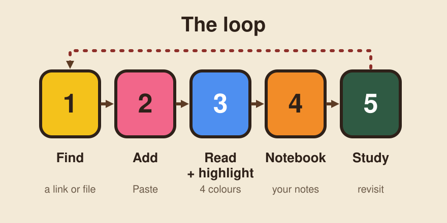
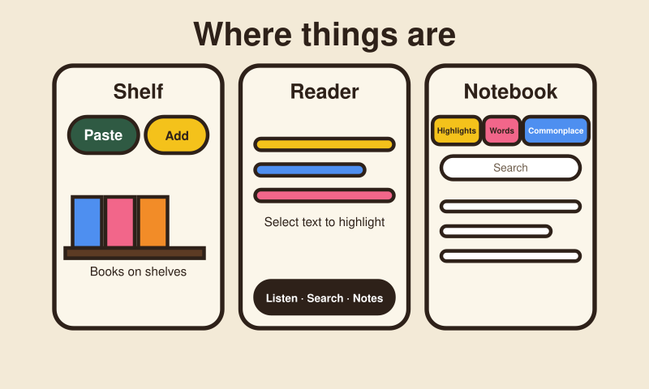
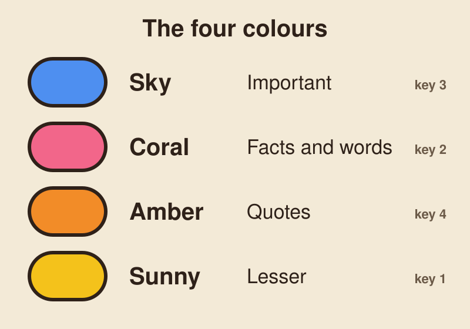

# own-shelf: user guide

own-shelf is a reading app. You keep articles, PDFs and Kindle notes on one shelf, read them, highlight what matters, and come back to your notes later. *Knowledge is power. Wisdom in the margins.*

## Get started on an iPhone

1. Open https://ngnnah.github.io/own-shelf/ in **Safari**.
2. Tap **Share**, then **Add to Home Screen**. own-shelf now opens like an app.
3. Sign in with **Google**, or choose **Use on this device only**. Signing in keeps your shelf on all your devices. "This device only" keeps it in that one browser.

## Add something to read

- **Paste.** Copy a link or an article's text, open own-shelf, tap **Paste**. A link is fetched and added. Copied text opens the Add dialog with the text filled in.
- **Add to shelf.** Choose a link, pasted text or a file (PDF, Markdown, a Kindle "Notebook Export").
- **Share sheet.** In Safari, share a page straight to own-shelf with a one-time Shortcut. The setup is step 7 of [Make your own shelf](../README.md#make-your-own-shelf).

## Read

Select text to open the toolbar.

- **Highlight** in one of four colours. The meanings above are the defaults. Tap a highlight to change its colour or add a **note**.
- **Word.** Select a word to save it with its sentence and see its meaning.
- **Listen.** Tap Listen in the reader bar to hear the page read aloud. Pause and Resume sit in the same place.
- **Search** inside a book from the reader bar.
- **Fast-scroll handle.** Drag the handle at the edge to jump through a long text.

## After reading: the Notebook

The Notebook gathers what you saved from every book.

- **Highlights.** Search them, filter by book or colour, or show only those with a note.
- **Words.** Your saved words. Tap **Study** for flashcards. They come back on a schedule, so words you miss return sooner.
- **Commonplace.** Your own notes, lessons and journals, by month. Add an entry by typing or with Paste. Put #tags in the text and each tag becomes a topic you can browse.
- **Export** your highlights and notes as Markdown, HTML or plain text.

On the shelf, **Shelves** sort books into categories such as Travel or History. Drag a book onto a shelf. **Grid** view shows Unsorted books in a tray at the top and one tile per shelf, so you can sort many books fast.

## Stay safe

- **Undo.** After you remove a book, highlight, note, word or shelf, a message offers **Undo** for a few seconds.
- **Trash.** Settings, then Trash, keeps removed items for 30 days. Restore them there. "Delete forever" and "Empty Trash" cannot be undone, and ask you to type "yes".
- **Backups.** Settings has backup and restore. Save a backup file now and then, especially if you use "this device only".

## Best way to use it

1. **Paste paywalled articles.** Copy the text, tap Paste, and it is yours to keep and highlight.
2. **Keep the colours meaningful.** Sky for what matters, Coral for facts and words, Amber for quotes, Sunny for the rest. The Notebook filters then work for you.
3. **Add a note** to anything you might not understand in a month.
4. **Study a few minutes a day.** Small and regular beats long and rare.
5. **Sort books onto shelves** as you add them, so Unsorted stays short.
6. **Write in Commonplace** after a book: one lesson, with a #tag.
7. **Back up** before big changes.
