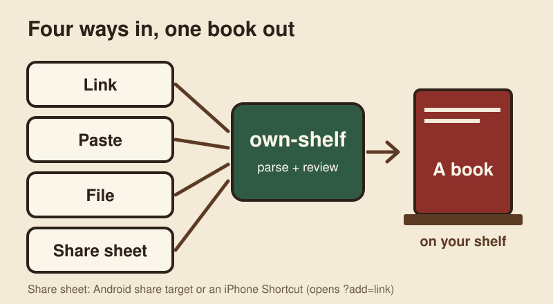
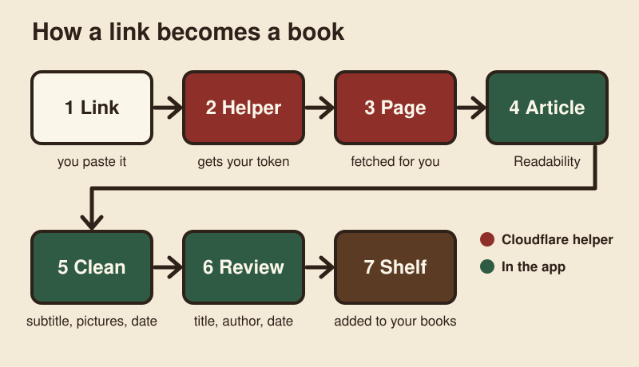
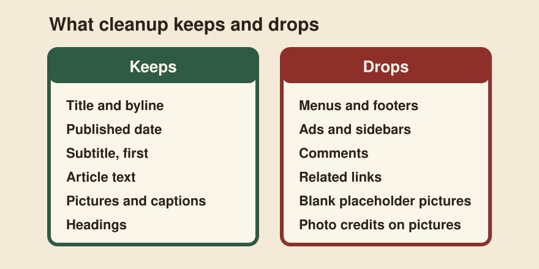

# How import works

own-shelf turns what you bring in into a book on your shelf. This page covers the four ways in, and what happens to a link.

## What you can bring in

**A link.** Press Add to shelf, paste the link, check the result, add it. The helper fetches the page without your login, so a paywalled page comes back as the paywall. For those, copy the article in the page and paste it instead. Link import needs a signed-in account and a helper (see the README's step 6); without one, the other ways still work.

**A paste.** Paste an article into the Add dialog, rich text or plain. Rich text keeps headings, links and pictures. The shelf's **Paste** button reads your clipboard in one tap: a lone link is added as a link, anything else opens Add with the text filled in. Pictures are shrunk to fit.

**A file.** Drop or choose a PDF, a Markdown file, an HTML file or a Kindle "Notebook Export" (.html). A PDF is read as text. A Kindle export becomes a book of your highlights in their colours, with your notes. A newer export of the same book merges into the old one. Several files at once are added without the review step.

**The share sheet and `?add=`.** Opening `https://<your-site>/?add=<link>` adds that link as if you had pasted it. `?url=` and `?text=` work the same way. On Android, the installed app is a share target (declared in the PWA manifest), so it appears in the share sheet. On iPhone there is no share target: set up the "Send to own-shelf" Shortcut, which opens that `?add=` address (README, step 7). It needs the same sign-in and helper as a link.

## How a link becomes a book

1. The app sends the link to the helper, a small Cloudflare Worker, with your Firebase sign-in token.
2. The helper checks the token and that your email is allowed, then fetches the page. It refuses private addresses and files over 15 MB.
3. The page comes back to the app. PDFs and Markdown skip to cleanup; HTML goes through the steps below.
4. The app finds the article with Readability, the library behind browser reader modes.
5. The app cleans it: it finds the subtitle and puts it first, drops placeholder pictures, and looks for a published date when the page has no clear one.
6. You review the title, author and date, and edit them if they are off.
7. Add puts the book on your shelf.

## Limits

- Pages that need your login, or load their text with scripts, import partly or not at all. Copy and paste them.
- Extraction is a guess. Check the review step; some pages lose a box or keep a stray line.
- Adding a book that is already on your shelf opens the existing one instead of making a copy. Kindle exports are the exception: a newer one merges new highlights in.
