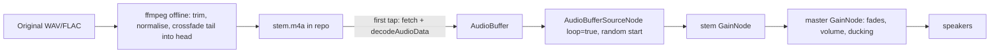

# Ambient sounds: research (2026-10-29)

Research for a later spec. Nothing has been built.

## Bottom line

- **Sources.** Freesound's CC0 filter covers all nine environments. The NPS park libraries add a few public-domain clips. Wikimedia Commons and the Internet Archive add almost nothing new. CC-BY isn't needed anywhere.
- **No natural match:** an ancient library and a dark fantasy world. The library becomes old-room tone plus a faint fire and wind under a door. Dark fantasy becomes wind singing on a mountain at night.
- **Playback.** Bake each stem into a seamless loop offline. Decode it with Web Audio and loop it sample-accurately. Start each stem at a random point, and fade with gain nodes. Use at most two stems of unrelated lengths. Pause when the app is hidden instead of fighting iOS.
- **Size.** Use AAC in `.m4a` at 96 kbps stereo, which is 0.72 MB a minute. Nine environments come to about 40 MB, cached only when first played. That's well inside GitHub's limits.
- **Not listened to.** I picked from the uploaders' descriptions plus a loudness scan of each preview (see "How I checked"). Nhat should listen to each pick before any file is committed.

## How I checked

- **Licence, format and length** come from each sound's own Freesound page, fetched on 2026-10-29. Every Freesound pick below shows "Creative Commons 0" on its page.
- **Loudness scan.** I ran ffmpeg's EBU R128 meter over Freesound's low-quality preview of each pick (the file was deleted after reading). Two numbers appear in the tables:
  - **LRA**, the loudness range in LU. It's low for steady sound: under 7 is steady, 7 to 11 varies, and over 12 swings.
  - **Spike**, the loudest 0.4 s moment minus the median 3 s loudness, in dB. Under 10 means no sudden events. Over 15 means something jumps out; its time is noted where it matters.
- **What I didn't do:** listen. The scan can't hear a voice, a rhythmic creak or a single bird that marks the loop.

## Candidates by environment

Links go to the sound's page. Lengths are minutes:seconds. "WAV 48k" means the original upload.

### 1. An ancient library (no natural match)

A real library has voices, doors and beeps, so it fails the rules. The stand-in layers a quiet stone room, a faint fire and a low wind under a door.

| Candidate | Licence, format | Length | What's audible |
|---|---|---|---|
| [Old Castle, empty room, morning](https://freesound.org/people/mogrm/sounds/774374/) (mogrm) | CC0, WAV 48k | 8:07 | Old-castle room tone. Very quiet (−59 LUFS), so it needs gain. LRA 7, spike 13. **Base layer.** |
| [Low Wind Howling Indoor](https://freesound.org/people/Kinoton/sounds/815100/) (Kinoton) | CC0, WAV 48k | 3:18 | Low wind through a door gap. LRA 7, spike 9. Mix it very low. |
| [fireplace-jim](https://freesound.org/people/hovercraft/sounds/66412/) (hovercraft) | CC0, AIFF 48k | 4:13 | Small fire with room ambience, soft pops. LRA 5, spike 15. Use it far back as a "distant fire". |

Rejected: [Library ambience](https://freesound.org/people/morosopher/sounds/173344/) (people talking, doors, lending-machine beeps), [Swedish Library](https://freesound.org/people/JonnyThePonny/sounds/232602/) (voices) and [Cathedral Ambience 1](https://freesound.org/people/Quistard/sounds/174279/) (organ, visitors talking).

### 2. A dark fantasy world (no natural match)

No real place fits, and "dark fantasy" sound design is usually music or synthetic drones. The stand-in is wind howling on a mountain at night: eerie but natural.

| Candidate | Licence, format | Length | What's audible |
|---|---|---|---|
| [Wind singing in the mountain, some night cricket](https://freesound.org/people/felix.blume/sounds/165526/) (felix.blume) | CC0, WAV 96k | 3:50 | Wind howling on a sacred mountain in Mexico at night, faint crickets. LRA 6, spike 7, the steadiest pick of all. **Pick.** |
| [winter wind 01c](https://freesound.org/people/klangfabrik/sounds/117513/) (klangfabrik) | CC0, AIFF 44.1k | 6:32 | Cold howling wind. LRA 10, spike 9. A good second stem. |
| [Sea Cave](https://freesound.org/people/Andy_Gardner/sounds/196713/) (Andy_Gardner) | CC0, WAV 96k | 5:11 | Waves and water dripping in a cave on the Ayrshire coast. LRA 3, spike 10. Check the drips aren't a steady beat. |

Rejected: [mystic wind howling](https://freesound.org/people/launemax/sounds/250036/) (reverb added, LRA 18, too theatrical) and [Howling winter storm](https://freesound.org/people/DBlover/sounds/505999/), a mix of other users' recordings, so its CC0 depends on theirs.

### 3. A tropical beach

| Candidate | Licence, format | Length | What's audible |
|---|---|---|---|
| [Ocean Waves - Sounds](https://freesound.org/people/MamickaBeeGames/sounds/803330/) (MamickaBeeGames) | CC0, WAV 44.1k | 15:00 | Waves on a shore, location not given. LRA 7, spike 6. Long and steady. **Pick.** |
| [thai-tropics-ocean-surf](https://freesound.org/people/trubalesk/sounds/651239/) (trubalesk) | CC0, WAV 48k | 3:48 | Surf on Ko Lanta, Thailand. LRA 7, spike 11. |
| [Light rain in a field of banana trees](https://freesound.org/people/felix.blume/sounds/512334/) (felix.blume) | CC0, WAV 96k | 10:00 | Tropical light rain on broad leaves in Mexico. LRA 3.5, spike 16 at 2:14 (cut around it). An optional rain layer. [Morning rain on Kauai](https://freesound.org/people/vanoosbree/sounds/340029/) (5:21, iPhone 6, LRA 5) is a lighter alternative. |

Rejected: [Tropical Island](https://freesound.org/people/richwise/sounds/451743/), with boats chugging past and a koel calling (spike 19), and [Binaural Beach Waves 4](https://freesound.org/people/Benbojangles/sounds/457149/), with 8–12 ft waves rolling football-sized rocks (too loud).

### 4. An old primeval wood (redwoods) or the Black Forest

I found no clean CC0 redwood recording. [The one redwood campground recording](https://freesound.org/people/kyles/sounds/452450/) has highway traffic, and NPS's Muir Woods stream clip lasts 5 seconds. Conifer wind from elsewhere stands in.

| Candidate | Licence, format | Length | What's audible |
|---|---|---|---|
| [Clark's Tower Ambience 4 RX](https://freesound.org/people/greysound/sounds/547922/) (greysound) | CC0, FLAC 48k | 7:40 | Strong wind through tall trees, distant birds, creaking trunks. LRA 11, spike 8. **Pick.** |
| [Pinewood In Memoriam](https://freesound.org/people/klankbeeld/sounds/383506/) (klankbeeld) | CC0, FLAC 48k | 29:20 | Calm winter pinewood in the Netherlands, made as a long, peaceful piece. LRA 4. One spike at 28:53: cut the end. |
| [Little stream & whooshing wind](https://freesound.org/people/morosopher/sounds/185987/) (morosopher) | CC0, FLAC 44.1k | 12:07 | Snowmelt stream with constant wind high in the trees, occasional birds. LRA 4, spike 12. |

Public-domain alternative: Yellowstone's ["Lower Geyser Basin, strong wind in trees"](https://www.nps.gov/yell/learn/photosmultimedia/sounds-soundscapes.htm). It's a 4:59 binaural MP3 at 192 kbps, credited NPS/Peter Comley. I didn't scan its loudness. The Yellowstone library says its files "are in the public domain" and "may be downloaded and used without limitation" ([sound library](https://www.nps.gov/yell/learn/photosmultimedia/soundlibrary.htm)).

### 5. Windswept craggy highlands

| Candidate | Licence, format | Length | What's audible |
|---|---|---|---|
| [Wind Over Holehead Hill](https://freesound.org/people/Sandy-Ogilvie/sounds/847257/) (Sandy-Ogilvie) | CC0, WAV 44.1k | 3:20 | Wind sweeping across the grass on the Campsie Fells, Scotland, with mics behind a wall. My loudness scan failed. **Pick**, if it passes a listen. |
| [WNW Wind and Snow on Holehead Hill](https://freesound.org/people/Sandy-Ogilvie/sounds/849302/) (Sandy-Ogilvie) | CC0, WAV 48k | 6:22 | High wind and snow through a drystone wall gap. LRA 11, spike 17 at 4:10. The uploader mentions creaks from the windshield: listen first. |
| [Wind in the grass of a Patagonian plain](https://freesound.org/people/felix.blume/sounds/139337/) (felix.blume) | CC0, WAV 48k | 3:01 | Wind in grass with trees behind it. LRA 14, spike 12. |

Public-domain alternative: Rocky Mountain's ["Tundra ambient, Medicine Bow Curve"](https://www.nps.gov/romo/learn/photosmultimedia/sounds-ambient-soundscapes.htm), 6:43, MP3 192 kbps, LRA 12. The same page has "Wind, Gem Lake" (4:31, LRA 10). The park says its files are "public domain and may be downloaded and used without limitation" ([ROMO library](https://www.nps.gov/romo/learn/photosmultimedia/soundlibrary.htm)).

Rejected: [windy mountain plains](https://freesound.org/people/dwightsabeast/sounds/321412/) (interference, LRA 18) and [Tramontane on the Canigou](https://freesound.org/people/davidlagarde/sounds/759918/) (a flag flapping, people talking).

### 6. A water village

| Candidate | Licence, format | Length | What's audible |
|---|---|---|---|
| [Venise_Gondola_Lapping_water](https://freesound.org/people/nicotep/sounds/843242/) (nicotep) | CC0, AIFF 48k | 3:42 | Small waves splashing against gondolas, with a low rumble of distant water buses. LRA 5, spike 8. **Pick.** |
| [Venise_small_Boat_Lapping_water](https://freesound.org/people/nicotep/sounds/843246/) (nicotep) | CC0, AIFF 48k | 3:04 | The same shore at night, with some creaks and squeaks. LRA 6, spike 8. |
| [Flowing water in a canal after a storm, insects at midnight](https://freesound.org/people/lastraindrop/sounds/744133/) (lastraindrop) | CC0, WAV 48k | 12:20 | A canal flowing, with night birds and insects and no people. LRA 0.5, spike 1.5, extremely steady. A good bed under the gondolas. |

Rejected: [Venezia Canal Grande early morning](https://freesound.org/people/emanuele.caro/sounds/449721/) (motor boat, gulls, LRA 16) and [Rainy Rooftop in Venice](https://freesound.org/people/saorenjoyer/sounds/688064/) (voices, droning boats).

### 7. A Japanese zen rock garden

A dry rock garden is nearly silent, and its classic sounds break the rules. The shishi-odoshi clacks on a beat, and a suikinkutsu is a drip. The stand-in is soft water, wind in bamboo and light rain.

| Candidate | Licence, format | Length | What's audible |
|---|---|---|---|
| [Birds, wind through bamboo and a little waterstream - Japan](https://freesound.org/people/tomasloos/sounds/843520/) (tomasloos) | CC0, WAV 48k, binaural | 3:26 | A bench by a small bamboo grove and stream. Quiet (−50 LUFS), and the birds make it uneven (LRA 18). **Pick** for character; check the birds. |
| [morning stream 1 - close mono](https://freesound.org/people/s-light/sounds/514683/) (s-light) | CC0, FLAC 48k, mono | 45:07 | A small stream gurgling over stones in southern Germany. LRA 0.9. A bumblebee passes at 43:13: cut the end. A steady water bed. |
| [Shin-Nakano rain on a balcony](https://freesound.org/people/markystar/sounds/75069/) (markystar) | CC0, WAV 44.1k | 4:50 | Late-night rain in Tokyo. LRA 0.6, spike 1.0. Urban, but even and calm. |

Rejected: [Ina night fields](https://freesound.org/people/RutgerMuller/sounds/361875/) (an air conditioner buzzes) and [Yukinoura bamboo forest](https://freesound.org/people/RutgerMuller/sounds/368823/) (beside a main road, LRA 19).

### 8. A rustic cabin with a fireside reading nook

| Candidate | Licence, format | Length | What's audible |
|---|---|---|---|
| [Fireplace for Six Minutes (Stereo)](https://freesound.org/people/petebuchwald/sounds/496130/) (petebuchwald) | CC0, WAV 44.1k | 6:09 | A fireplace, cleanly recorded. LRA 3.5, spike 13, the steadiest fire found. **Pick.** |
| [Forest Rainstorm 02](https://freesound.org/people/rifualk/sounds/648475/) (rifualk) | CC0, WAV 48k | 11:58 | Wind and rain in the trees, heard from a cabin window in Wisconsin. No thunder, some awning drips. LRA 7, spike 8. The uploader says it loops seamlessly. A rain layer. |
| [Rain from Half Open Window 1](https://freesound.org/people/RutgerMuller/sounds/158690/) (RutgerMuller) | CC0, AIFF 48k | 5:08 | Rain on walls and windows, a few drops through the window. LRA 2, spike 6. A softer rain layer. |

Rejected: [Crackeling Fireplace](https://freesound.org/people/courter/sounds/447818/) (wet pine chosen for "consistent popping", LRA 22) and [Early Morning Rain by Casco Bay](https://freesound.org/people/be-steele/sounds/362415/) (crows, and a gull at 19 min). [Aachen fireplace](https://freesound.org/people/visionear/sounds/501417/) (11:54) works only if cut before its spike at 10:56.

### 9. A ship's reading room at sea

| Candidate | Licence, format | Length | What's audible |
|---|---|---|---|
| [Cruise ship cabin room tone](https://freesound.org/people/richwise/sounds/806017/) (richwise) | CC0, WAV 48k | 5:10 | An empty cabin on a cruise ship at sea: a steady hull and engine hum. LRA 1.5, spike 4. **Base layer.** |
| [sailboat front cabine](https://freesound.org/people/bruno.auzet/sounds/760339/) (bruno.auzet) | CC0, WAV 48k | 3:30 | Water rushing past the hull at 5 knots. LRA 5, spike 10. The uploader warns of "sometimes radio": find and cut it. |
| [Tokyo–Kyushu ferry cabin in a squall](https://freesound.org/people/chromakei/sounds/751841/) (chromakei) | CC0, FLAC 96k, binaural | 8:55 | Waves on the hull, the cabin creaking as the ferry rocks. LRA 6, spike 16 at 7:49. The creaks may follow the roll. |

Rejected: [Moored sailboat interior](https://freesound.org/people/AugustSandberg/sounds/265553/) (straining ropes, LRA 13, spike 19), [interior sailboat sailing](https://freesound.org/people/falisca/sounds/660905/) (crew laughing at 2:56) and [Sailing on the Baltic](https://freesound.org/people/hajohansen/sounds/157365/) (a radio gale warning, so a voice).

## Sources and licences

- **Freesound, CC0 filter:** the main source. CC0 waives all rights: you "can copy, modify, distribute and perform the work, even for commercial purposes, all without asking permission" ([CC0 deed](https://creativecommons.org/publicdomain/zero/1.0/)). It rests on the uploader owning the recording, so avoid mixes built from other people's sounds unless every source is CC0.
- **US National Park Service:** public domain, with credit requested ("please give the appropriate credit"; [NPS gallery](https://www.nps.gov/subjects/sound/gallery.htm)).
  - The main gallery's ocean, stream and rain clips are 5–7 seconds long, too short.
  - Yellowstone and Rocky Mountain have 3–42 minute soundscapes. Many have birds, elk, coyotes or aircraft.
  - Some Yellowstone clips are credited "NPS & MSU Acoustic Atlas". The page still calls all its files public domain, but confirm before using one of those.
- **Wikimedia Commons:** few long CC0 ambiences. One worth keeping is [Snowmelt flowing into lake at Okanagan Mountain Provincial Park](https://commons.wikimedia.org/wiki/File:Snowmelt_flowing_into_lake_at_Okanagan_Mountain_Provincial_Park.flac) (CC0, FLAC, 32:40), a spare water bed. Searches mostly returned public-domain speeches and band music.
- **Internet Archive:** the licences are typed in by uploaders. Many CC0 nature items are mirrors of Freesound sounds (identifiers start `soundica-fs-`). Use the Freesound original, which has the uploader's own page.
- **CC-BY:** not needed. If one is ever used, add a `CREDITS` line with the author, link and licence.

### Free but not redistributable: avoid

| Source | Why not |
|---|---|
| BBC Sound Effects (RemArc) | BBC copyright, for personal, educational or research use only. Commercial use needs a paid licence ([coverage](https://www.sonicstate.com/news/2018/04/18/the-bbc-are-offering-16000-free-sound-effects/), [cdm.link](https://cdm.link/bbc-gives-away-16k-wav-sound-effects-disallows-using/)). Raw files in a public repo go beyond that. |
| Sonniss GDC bundles | "Licensee may not distribute, publish, sub-license or otherwise supply the sound effects as sound effects", modified or not ([licence](https://sonniss.com/gdc-bundle-license/)). Raw files in a public repo do exactly that. |
| Pixabay (and similar "royalty-free" sites) | "You cannot sell or distribute Content … on a Standalone basis" ([Pixabay licence](https://pixabay.com/service/license-summary/)). Pixabay hasn't been CC0 since 2019. I didn't check Mixkit or ZapSplat. |
| YouTube Audio Library | No blanket permission outside YouTube; each file has its own terms ([guide](https://licenseorg.com/guide/music-audio/youtube-audio-library)). |
| Western Soundscape Archive (Univ. of Utah) | CC BY-NC-ND 3.0 per its pages: no commercial use, no derivatives. That rules out loop edits. |

## Playback on an iPhone

### Recommended loop design

1. **Bake the seam offline.** For each stem, cut a calm 3–6 minute stretch. Crossfade its last 5–8 s into its first 5–8 s with ffmpeg, so the file's end flows into its start. Normalise every stem to the same loudness, about −30 LUFS, so switching rooms doesn't jump. These are one-time steps, not app code.
2. **Loop sample-accurately in Web Audio.** Fetch the file and decode it into an `AudioBuffer`. Play it with `AudioBufferSourceNode`, `loop = true`. Buffer loops are sample-accurate ([MDN](https://developer.mozilla.org/en-US/docs/Web/API/AudioBufferSourceNode/loop)). A plain `<audio loop>` leaves a short gap at the loop point, which is audible on noise-like sound.
3. **Random start.** `source.start(0, Math.random() * buffer.duration)`, so each session starts somewhere new.
4. **Layer at most two stems, of unrelated lengths.** For example, wind 3:50 under fire 6:09: the pair lines up again only after hours. Leave out stems with one memorable event (a single bird call, a loud pop), because that event marks the loop.
5. **Fades.** Ramp the master gain: about 3 s to fade in, 1.5 s to fade out, and a 3 s crossfade when the theme changes.
6. **Volume.** An in-app slider on the master `GainNode`, starting at about 40%. On iOS, `<audio>.volume` can't be set from JavaScript, so fades and volume need a `GainNode` either way ([WebKit change](https://bugs.webkit.org/show_bug.cgi?id=241657), [Apple forum](https://developer.apple.com/forums/thread/82939)).
7. **Memory.** Web Audio holds decoded audio as 32-bit floats, about 23 MB a minute in stereo at 48 kHz. Keep each environment's stems to 4–5 minutes in total (90–115 MB). Drop the buffers when the theme changes.

The alternative is two `<audio>` elements per stem, crossfading through `createMediaElementSource`. It streams, so it uses little memory, but it needs a timer per stem and still needs Web Audio for gain. It's the fallback only if memory turns out to be a problem.

### Starting, locking and switching apps

- **The tap.** Create the `AudioContext`, or call `resume()`, inside the tap on an Ambience control. iOS won't start audio without a user gesture.
- **The silent switch.** Web Audio on iOS is "ambient" by default: it mixes with other apps and obeys the silent switch ([unmute.js notes](https://github.com/swevans/unmute)). `navigator.audioSession.type`:
  - `"ambient"` mixes with Nhat's own music and goes quiet when the switch is on silent.
  - `"playback"` plays through the switch but pauses other apps' audio ([MDN](https://developer.mozilla.org/en-US/docs/Web/API/AudioSession/type)).
  - The choice is one of the open questions below.
- **Locked screen or another app:**
  - With `"playback"`, Web Audio should keep playing in the background since iOS 17.5 ([WebKit bug 261554](https://bugs.webkit.org/show_bug.cgi?id=261554), fixed).
  - But home-screen apps have open iOS 26 regressions: an `AudioContext` stays silent after the app returns from the background, even after `resume()` ([bug 291892](https://bugs.webkit.org/show_bug.cgi?id=291892)). An `<audio>` element plays silence after the app is reopened ([bug 295518](https://bugs.webkit.org/show_bug.cgi?id=295518)). One tester reports 291892 fixed in iOS 26.2 beta 3, but that's unconfirmed.
- **Recommendation:** on `visibilitychange` to hidden, fade out and `suspend()`. On return, `resume()` from the next tap. If it hangs or stays silent, close the context and build a new one from the cached buffers. Ambience isn't needed with the screen locked, and Listen's `speechSynthesis` stops on lock anyway (see the [listening research](2026-10-26-listening-research.md)).

### Living with Listen (`speechSynthesis`)

- **Duck, don't stop.** When an utterance starts, ramp the ambience to about 30% (−10 dB) over 0.5 s. Bring it back over 1 s once no utterance has started for 1 s, so it doesn't pump between sentences.
- A setting could offer "Pause ambience while listening" instead.
- **Not verified:** whether iOS mixes `speechSynthesis` with a running `AudioContext`, or one interrupts the other. Test it on the phone before building the duck.

## Size and hosting

- **Codec: AAC-LC in `.m4a`.** Safari, Chrome and Firefox all play it and decode it with `decodeAudioData`.
  - Opus would save a third (64 kbps is enough), but iOS support is patchy. Ogg Opus only arrived in iOS 18.4, and before that Opus was only "partial" ([caniuse](https://caniuse.com/opus)).
  - WebM Opus works in `<audio>`, but reports on `decodeAudioData` disagree ([WebKit bug 245428](https://bugs.webkit.org/show_bug.cgi?id=245428), [Safari 18.4 notes](https://developer.apple.com/documentation/safari-release-notes/safari-18_4-release-notes)).
  - One format means one encode and no fallback code.
- **Bitrate** (MB per minute = kbps × 60 / 8000):

| Encoding | MB per minute | Use for |
|---|---|---|
| AAC 96 kbps stereo | 0.72 | Wind, surf, rain, water |
| AAC 64 kbps mono | 0.48 | Fire, room tone, ship hum |
| Opus 64 kbps stereo | 0.48 | Not used (iOS support) |

- **Total:** nine environments at about 6 minutes of stems each (one or two stems) is about 54 minutes. At mostly 96 kbps that's **about 40 MB**, with a range of 25–65 MB.
- **GitHub limits:**
  - Pages sites may be up to 1 GB, with a soft 100 GB a month of bandwidth ([Pages limits](https://docs.github.com/en/pages/getting-started-with-github-pages/github-pages-limits)).
  - The repo has a recommended 1 GB limit. Git warns at 50 MB per file and blocks files over 100 MB.
  - Every re-encode stays in git history forever, so settle the encodes before the first commit. Git LFS files aren't served by Pages, so don't use LFS.
- **Cache on first play, with no service-worker change:**
  - `sw.js` already caches every same-origin GET it fetches successfully (network first, 4 s timeout, cache fallback). Leave the audio out of `SHELL`, and the first `fetch()` of a stem caches it.
  - Fetching the whole file for `decodeAudioData` sends no `Range` header. That avoids the 206 partial responses the Cache API rejects, which `<audio src>` would trigger.
  - Two side effects. Each play revalidates with a cheap 304. And a rename of `own-shelf-v1` clears the audio along with the shell.

## Risks

- **Unheard picks.** A voice, a dog or a rhythmic creak may hide below the loudness scan. Listen to each full file before baking.
- **iOS 26 home-screen bugs** can leave audio silent after the app has been backgrounded. Plan for a rebuild-the-context path and a visible "tap to resume".
- **Memory.** Decoded stems are large (23 MB a stereo minute). Budget about 5 minutes of stems per environment.
- **Licence provenance.** CC0 trusts the uploader. Prefer field recordings with gear and place named, as every pick above has, and skip mixes of other people's sounds.
- **NPS credit.** It's requested, not required. Keep a `CREDITS` file anyway, at no cost.

## Open questions for Nhat

1. Silent switch: should ambience mix with your own music and obey the switch (`"ambient"`), or play through it and pause other audio (`"playback"`)?
2. Should ambience stop when the phone locks (recommended), or must it keep playing locked? That only matters with generated Listen audio later.
3. While Listen speaks, duck the ambience to about 30% (recommended) or pause it?
4. One bed per environment, or up to two layered stems (for example fire plus rain in the cabin)?
5. Is a stand-in fine for the library (stone room, faint fire, wind under a door) and dark fantasy (mountain wind at night)?
6. Redwoods have no clean CC0 recording. Is conifer wind from elsewhere fine, or should we keep looking (for example, asking NPS Redwood or Muir Woods for longer public-domain clips)?
7. Should ambience come on with a theme by default, or only from an explicit toggle (recommended)?
